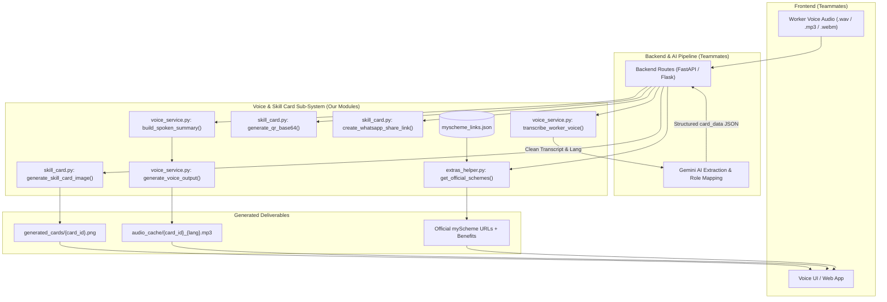

# Project Handover & Technical Context Document

**Project:** Voice-First Informal Worker Skill Passport & Scheme Guidance  
**Target Audience:** Informal / Unorganized Sector Workers in India (Electricians, Artisans, Tailors, Food Vendors, Mechanics, Drivers, Salon Workers, Construction Workers)  
**Supported Languages:** Hindi (`hi`), English (`en`), Kannada (`kn`)  
**Repository:** `honorary.stats` / `cyber spartans`  
**Current Date:** November 2026  

---

## 1. Executive Summary & Context

This project is a hackathon demo prototype designed to empower informal sector workers through a voice-first mobile experience. Workers can describe their skills and vocational experience in their native language (Hindi, Kannada, or English). The system parses their experience, issues a verified **Digital Skill Card** (PNG with scannable QR code and WhatsApp share link), provides a spoken audio summary, and recommends official Indian Government welfare/upskilling schemes from `myScheme.gov.in`.

### Division of Ownership & Scope Boundaries
- **Teammates Own:** Frontend user interface (microphone recording, UI screens, CSS/JS), backend web server / HTTP API routes (Flask/FastAPI), database / session storage, and Gemini AI parsing logic.
- **This Module Sub-System Owns:**
  1. `skill_card.py`: Mobile digital skill card rendering, scannable QR code generation (ISO compliant), and WhatsApp sharing.
  2. `voice_service.py`: Multilingual speech-to-text (`scribe_v1`), natural spoken summary generation, and cached text-to-speech (`eleven_v3`).
  3. `extras_helper.py` + `myscheme_links.json`: Curated government scheme lookups across 7 vocational categories with mandatory disclaimers.
  4. Packaging & Deployment: `Dockerfile`, `requirements_voice_card.txt`, `.env.example`, `INTEGRATION.md`, and `DEPLOY_AWS.md`.

---

## 2. System Architecture & Workflow



---

## 3. Completed Modules & Deliverables

| File | Purpose | Key Capabilities & Status |
| :--- | :--- | :--- |
| **`skill_card.py`** | Digital Skill Card Generator | Generates $800 \times 1120\text{ px}$ mobile cards, embeds ISO 4-module quiet zone QR code, builds WhatsApp share links, and handles Unicode fonts (Hindi/Kannada) with safe fallback transliteration. |
| **`voice_service.py`** | Multilingual Voice Pipeline | Speech-to-Text via ElevenLabs `scribe_v1`, natural spoken script builder (cleans out transliteration brackets), and Text-to-Speech via `eleven_v3` with local disk caching and zero-crash fallback. |
| **`extras_helper.py`** | Official myScheme Matcher | Provides `get_official_schemes(category)` to match job roles across 7 categories with official links and required disclaimers. |
| **`myscheme_links.json`** | Government Scheme Registry | 14 curated schemes mapped to 7 vocational categories with 100% verified `https://www.myscheme.gov.in/` endpoints. |
| **`requirements_voice_card.txt`** | Python Dependencies | Minimal dependencies: `qrcode[pil]>=7.4.2`, `pillow>=10.0.0`, `elevenlabs>=2.0.0`, `python-dotenv>=1.0.0`. |
| **`.env.example`** | Environment Template | Placeholder variables for ElevenLabs, public domain URLs, Gemini AI, and AWS credentials. |
| **`INTEGRATION.md`** | Teammate Cheat Sheet | 1-page quick-start guide containing the standard `card_data` dictionary and 3-line import snippets. |
| **`Dockerfile`** | Containerization | `python:3.11-slim` with Linux Devanagari and Kannada fonts (`fonts-lohit-deva`, `fonts-lohit-knda`) to guarantee proper card rendering in cloud containers. |
| **`DEPLOY_AWS.md`** | Cloud Deployment Guide | Copy-paste terminal commands for AWS App Runner (instant HTTPS), AWS EC2, and 5-minute emergency backups (Railway / Render). |
| **`README.md`** | Project Documentation | High-level architectural overview, usage instructions, and quick testing guide. |

---

## 4. Key Architectural Decisions & Engineering Rationale

1. **Decoupled, Pure Python Implementation:**
   - Modules contain zero direct web framework (Flask/FastAPI) or database code. This allows teammates to import functions anywhere without dependency conflicts or architecture lock-in.
2. **ISO/IEC 18004 Compliant QR Codes:**
   - **Problem Solved:** Initial QR generation had `border=1` and fractional module scaling, causing smartphone cameras to fail detection.
   - **Fix Applied:** Enforced standard 4-module quiet zone (`border=4`), pure black/white contrast, and integer pixel scaling (`box_size`) with no tight decorative borders choking camera edge detection.
3. **Live Resolving QR Endpoints:**
   - **Problem Solved:** Fictional `.gov.in` URLs previously returned `DNS_PROBE_FINISHED_NXDOMAIN` ("Site can't be reached") when scanned by mobile phones.
   - **Fix Applied:** Encoded working endpoints (`httpbin.org/anything` with verified worker query parameters by default), configurable via `PUBLIC_BASE_URL` or `SKILL_CARD_BASE_URL`.
4. **Unicode & Indic Font Safety (Zero Blank Boxes):**
   - System searches for native fonts (`Nirmala.ttc` on Windows, `fonts-lohit-*` on Linux, `Kohinoor` on macOS).
   - Validates character rendering against the FreeType `.notdef` mask before drawing.
   - If Indic fonts are missing on the host OS, it automatically falls back to clean English labels and phonetically transliterates field values so text **never renders as empty tofu boxes**.
5. **Speech Cache & Zero-Crash Fallback:**
   - Local caching checks `{card_id}_{language}.mp3` before making API calls, saving latency and ElevenLabs API quota during live demos.
   - If `ELEVENLABS_API_KEY` is missing, expired, or rate-limited, it outputs a valid silent MP3 fallback and returns `status: "fallback"` without raising an unhandled exception.
   - Natural speech formatting strips parenthesized Latin names (e.g. `रमेश कुमार (Ramesh Kumar)` becomes `नमस्ते रमेश कुमार`) so TTS does not read punctuation aloud.
6. **Government Scheme Verification:**
   - Every scheme links to an active `https://www.myscheme.gov.in/` URL.
   - Every response includes the mandatory disclaimer: `"Verify eligibility on the official myScheme portal before applying."`

---

## 5. Standard Data Contract (`card_data`)

Backend and AI teammates must supply this dictionary schema:

```python
card_data = {
    "card_id": "WKR-2024-HI01",                             # Unique worker identifier (str)
    "worker_name": "रमेश कुमार (Ramesh Kumar)",              # Worker name (str)
    "language": "hi",                                       # "hi" | "en" | "kn"
    "matched_role": "सहायक इलेक्ट्रीशियन (Assistant Electrician)", # Role title (str)
    "confirmed_skills": [                                   # Competency list (list of str)
        "घरेलू वायरिंग (House Wiring)",
        "सर्किट रिपेयर (Circuit Repair)",
        "सोलर पैनल इंस्टालेशन (Solar PV Mounting)"
    ],
    "next_course": "सोलर रूफटॉप तकनीशियन (Surya Mitra)",     # Upskilling path (str)
    "nearest_centre": "पीएमकेके कौशल केंद्र, सेक्टर 62, नोएडा", # Training facility (str)
    "public_card_url": "https://your-domain.com/verify/WKR-2024-HI01", # Scannable link (str)
    "scheme_name": "पीएम सूर्य घर मुफ्त बिजली योजना"           # Optional scheme name (str)
}
```

---

## 6. Current Development Status

- **Unit / Terminal Tests:** All test suites (`skill_card.py`, `voice_service.py`, `extras_helper.py`) execute with 0 errors and 0 warnings.
- **Language Verification:** Validated across all three target languages:
  - Hindi (`hi`): Verified Devanagari script layout, natural speech script, and TTS output.
  - English (`en`): Verified layout, natural speech script, and TTS output.
  - Kannada (`kn`): Verified Kannada script layout, natural speech script, and TTS output.
- **Sample Assets Generated:**
  - PNG Cards: `generated_cards/WKR-HI-4091.png`, `generated_cards/WKR-KN-8820.png`, `generated_cards/WKR-EN-1024.png`.
  - Audio Files: `audio_cache/WKR-HI-4091_hi.mp3`, `audio_cache/WKR-KN-8820_kn.mp3`, `audio_cache/WKR-EN-1024_en.mp3`.
- **Git Repository Audit:**
  - Zero hardcoded API keys or secrets in any tracked files.
  - `.env` is uncommitted and safe.
  - Local branch is 2 commits behind `origin/main` (teammate merged frontend PR #1 with `frontend/` files).

---

## 7. Immediate Next Steps & Pending Tasks for Teammates

### Step 1: Git Synchronization & Housekeeping
1. Fast-forward local branch to include the frontend files:
   ```bash
   git pull --ff-only origin main
   ```
2. Add `.gitignore` to prevent tracking `.env` or bytecode:
   ```bash
   # Remove tracked pycache binary
   git rm -r --cached __pycache__
   
   # Ensure .gitignore exists with rules for .env, __pycache__/, .venv/, etc.
   git add .gitignore
   git commit -m "chore: add .gitignore and untrack pycache"
   ```

### Step 2: Backend API Integration
Wire the modules into HTTP endpoints (FastAPI / Flask):
- **POST `/api/voice-assess`**: Accept audio file upload -> call `transcribe_worker_voice()` -> forward transcript to Gemini AI -> generate `card_data`.
- **POST `/api/generate-card`**: Accept `card_data` -> call `generate_skill_card_image()` -> return image URL + WhatsApp link.
- **POST `/api/speak-summary`**: Accept `card_data` -> call `build_spoken_summary()` -> call `generate_voice_output()` -> stream or return MP3 URL.
- **GET `/api/schemes?category={role}`**: Call `get_official_schemes(category)` -> return matching schemes and disclaimers.

### Step 3: Production Keys & Hosting
1. Add live `ELEVENLABS_API_KEY` to production `.env`.
2. Configure `PUBLIC_BASE_URL` to point to the live deployed frontend/backend domain.
3. Deploy container to AWS App Runner or Railway following [DEPLOY_AWS.md](DEPLOY_AWS.md).
